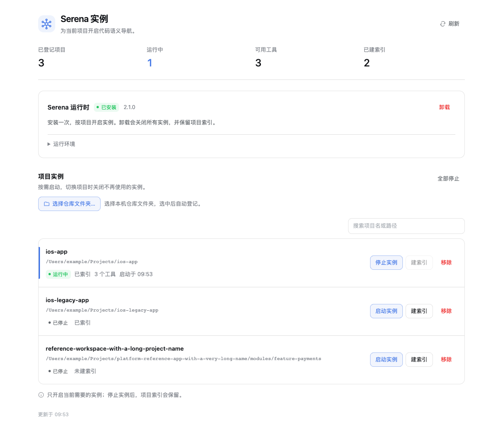
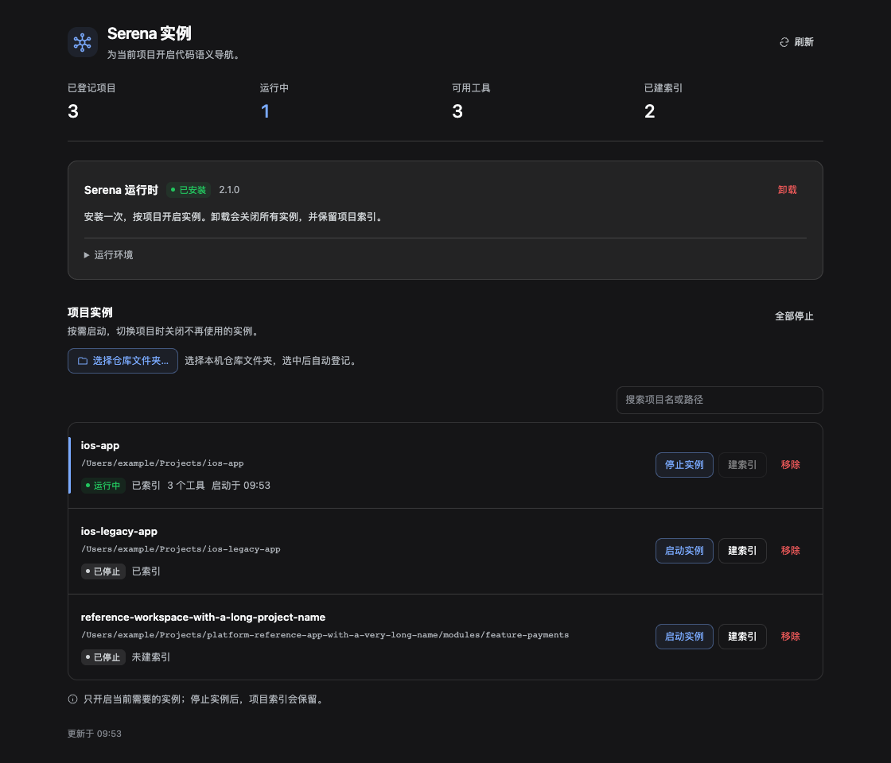
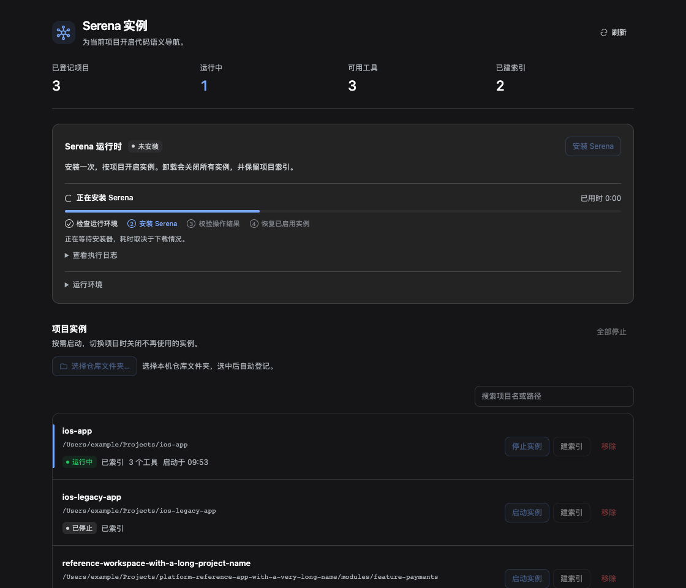
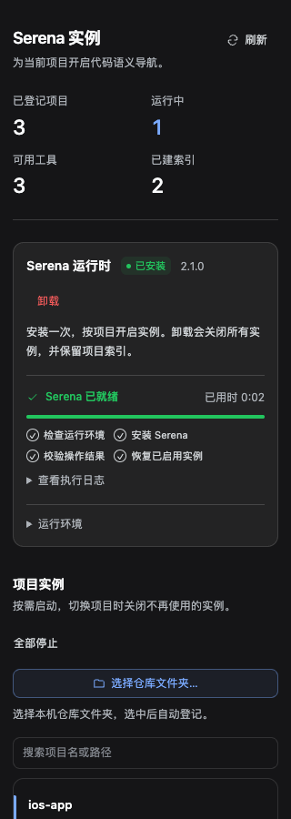

# serena-manager

Give the agent in DSH **semantic code navigation**: start Serena (LSP over MCP) per project and let it resolve definitions, find references and read symbol bodies instead of grepping the repo and reading whole files.

English · [简体中文](./README.md) · [Changelog](./CHANGELOG.md)



## What this plugin is for

This is not "yet another Serena manager". The point is to **change how the agent reads code**:

- Without it, an agent reads code through `grep` plus whole-file reads: one call-site search scans the repo, one function costs a whole file, tokens go to irrelevant code, and rename-sized changes leak.
- Serena exposes the LSP semantic layer over MCP: look up a symbol by name, ask who references it, fetch just the symbol body, edit by symbol. The unit becomes the symbol, not the file.
- But Serena runs **one MCP server per project**. Wiring it into DSH by hand means a profile edit and an app restart per project — and every live instance adds its tool schema to the model context.

So what this plugin delivers is **a semantic-navigation capability you can switch on and off**: it installs the runtime, starts and stops the per-project MCP server, builds the symbol index and exposes the tools to the agent — all from one side panel, with no profile edit and no restart. Managing Serena is the mechanism; the agent's navigation ability is the product.

What it deliberately does **not** do: bundle Serena (always the upstream `serena-agent`), replace a language server, or run several projects at once (that doubles the tool schema in context).

## What Serena is

[Serena](https://github.com/oraios/serena) is a language-server-backed toolbox for semantic code retrieval and editing, served to agents as an MCP server. It does not generate code. Its core operations:

| Capability | Typical call | Why it beats grep / whole-file reads |
| --- | --- | --- |
| Locate a definition | `find_symbol("OrderService.submit")` | One hit, no repo-wide scan |
| Find references | `find_referencing_symbols(...)` | Know the blast radius before renaming |
| File overview | `get_symbols_overview(path)` | See the skeleton, then read only what matters |
| Symbol-level edit | `replace_symbol_body(...)` / `insert_after_symbol(...)` | Touch the target symbol only |
| Pattern search | `search_for_pattern(...)` | Structured search that skips irrelevant files |

In DSH these arrive as **three MCP tools** (Serena v2's `--agent-interface repl` mode):

- `initial_instructions` — the project's usage notes (~2.3k tokens; read once)
- `activate_project` — switch to a project
- `serena_repl` — run a Python snippet that calls every semantic API above (symbol/reference search, file overviews, editing, refactoring, inspections)

The cost is real too: each running instance adds ~1.1k tokens of tool schema to context, which is why the panel is built around **one project at a time**.

## Compared with CodeGraph

The same need has a second route: **CodeGraph**. Instead of starting a language server, it parses the workspace with tree-sitter into a relation graph (definitions, calls, imports, inheritance) and lets the agent ask "who calls X", "what breaks if I change X", "can X reach Y".

- In the DSH ecosystem the counterpart is [@meteor-system/dsh-codegraph](https://github.com/Meteor-system/dsh-codegraph): one plugin, one `codegraph_explore` tool, read-only, index cached in `<project>/.dsh/codegraph/`, off by default and enabled per project.
- Further out there is the standalone engine [codegraph-ai/CodeGraph](https://github.com/codegraph-ai/CodeGraph): 38 languages, 42 MCP tools, vector search, a memory layer, VS Code / JetBrains plugins and PR impact analysis. That is a larger system, not the same small tool.

These are not substitutes. They are two different trade-offs:

| Dimension | This plugin (Serena / LSP) | CodeGraph (syntax graph) |
| --- | --- | --- |
| Mechanism | A real language server (sourcekit-lsp, pyright, tsserver, …); the type system takes part in resolution | tree-sitter extracts syntax facts into a graph; no type checking, no control flow |
| Precision | Type-exact; renames and signature changes are trustworthy | Every edge carries `exact` / `inferred` / `heuristic`; cross-file resolution is by qualified-name matching; C/C++ macros are not expanded |
| Questions it answers | Where is it defined, who references this symbol, file symbol overview, types and inheritance | Who calls X, what does changing X break (default depth 5), can X reach Y; the standalone engine also does entry points, circular deps and complexity |
| Can it edit code | Yes: `replace_symbol_body` / `insert_after_symbol` edit by symbol through the language server | No, queries are read-only |
| Indexing and startup | Language server boot + project index (seconds to tens of seconds), a long-lived process per project | First call scans the workspace (300s default budget, returns `indexing` when exceeded), then incremental refresh |
| Context cost | 3 tools, ~1.1k tokens of schema, instance stays live | 1 tool, very small schema |
| Prerequisites | uv + `serena-agent` + the matching language server (Swift needs Xcode / sourcekit-lsp) | Ships with the plugin; no language server or build environment |
| Language coverage | Whatever Serena can drive (dozens of languages officially) | Whatever grammars the plugin ships; unsupported languages return `unsupported_language` |
| Typical use | Refactoring, symbol-level edits, confirming the reference surface before a change | Getting oriented in an unfamiliar repo, call chains and impact analysis, reachability |

**How to choose**

- You are actively changing this repo and editing concrete symbols -> this plugin. A syntax graph can show the blast radius, but changing code correctly still needs the type system.
- You only want a quick "who calls whom", do not want a language server, and the project does not even build -> CodeGraph.
- In environments like iOS that need `xcode-select` / sourcekit-lsp: this plugin is more precise but heavier; CodeGraph works right after install, at the price of name-level precision.
- Both can be installed, but running both at once is not recommended: overlapping tools make the agent pick between two ways of saying the same thing, and both consume context. Switching per task is cheaper.

**Why LSP here instead of a home-grown graph**: the deliverable includes *editing code*. Replacing or inserting a symbol body without breaking types is something only a language server can guarantee; a syntax graph is good at answering relational questions, not at editing. That is why this plugin runs Serena instead of writing its own indexer.

## Screenshots

| Light | Dark |
| --- | --- |
|  |  |

| Install in progress | Narrow panel (320 px) |
| --- | --- |
|  |  |

The screenshots are rendered by `tests/ui-fixture.mjs` against the real DSH theme bundle, with a mocked HTTP backend and a mocked folder picker. They are a browser fixture, not a capture of the Electron app, and the demo projects are placeholders.

## Dependencies

| Dependency | Version | Purpose | Install |
| --- | --- | --- | --- |
| DSH desktop app | a build with the plugin API (`dsh.profile.bundles` + client slots) | The host; the panel and the tool run inside it | Install from your DSH distribution |
| Node.js | ≥ 20 | Plugin runtime (`engines`); skip if DSH ships its own node | `brew install node` or nvm |
| pnpm | ≥ 8 | `dsh plugin` forwards its arguments to pnpm in the profile | `corepack enable` or `npm i -g pnpm` |
| uv | ≥ 0.4 | Installs/uninstalls Serena | `curl -LsSf https://astral.sh/uv/install.sh \| sh` |
| Serena | 2.x (`serena-agent`) | The semantic navigation itself | Installed by this plugin; manual equivalent below |
| Xcode / Swift toolchain | — | Swift projects only: indexing needs sourcekit-lsp | App Store, or `xcode-select --install` |

Manual Serena install (what the panel's **Install Serena** button does; lands in `~/.local/bin/serena`):

```bash
uv tool install -p 3.13 serena-agent
serena --version          # expect Serena 2.1.0 or newer
```

If `uv` is neither at `~/.local/bin/uv` nor on `PATH`, point the plugin at it:

```bash
export SERENA_MANAGER_UV=/opt/homebrew/bin/uv
```

## Install the plugin (by hand)

Clone anywhere and register it as a linked package:

```bash
git clone https://github.com/PetterWong-L/serena-manager.git
cd serena-manager
```

Register it in your DSH profile (`~/.dsh/profiles/<profile>/package.json`) in two places: the link goes in `dependencies`, the name goes in `dsh.profile.bundles` (a dependency alone is not loaded).

```json
{
  "dependencies": {
    "@local/serena-manager": "link:/absolute/path/to/serena-manager"
  },
  "dsh": {
    "profile": {
      "bundles": ["@local/serena-manager"]
    }
  }
}
```

Install it into the profile:

```bash
dsh plugin --profile desktop install
```

Restart DSH (or let HMR pick it up) and **Serena 实例 / Serena Instances** appears in the side panel. If the CLI reports `profile "desktop" is managed exclusively by the Electron application`, the desktop app owns that profile: run `pnpm install` inside the profile directory (`dsh plugin` only forwards its arguments to that pnpm), or install through the app's own plugin settings. The bundle patch lives in `cordis.patch.yml` and carries no machine-specific paths; override the registry/log location in the profile's patch layer:

```yaml
- insert:
    - id: serena-manager
      name: '@local/serena-manager'
      config:
        storageDir: /some/other/place/serena-manager
```

## Install instructions for an AI agent

Hand the block below to an agent (Codex, Claude Code, a DSH agent — any of them) that can run commands on the machine. It checks prerequisites, installs, then verifies instead of trusting exit codes.

```text
Install and verify the DSH plugin serena-manager on this machine, which already has the DSH desktop app.
Repository: https://github.com/PetterWong-L/serena-manager

Work in order, report the real output of each step, and stop to explain if something fails. Do not guess.

1. Prerequisites (install what is missing)
   - node -v (>= 20), pnpm -v (>= 8; `corepack enable` if missing)
   - uv --version or ls ~/.local/bin/uv (else: curl -LsSf https://astral.sh/uv/install.sh | sh)
   - dsh --version (must be a build with the plugin API)

2. Clone to a stable location, e.g. ~/dsh/serena-manager
   git clone https://github.com/PetterWong-L/serena-manager.git ~/dsh/serena-manager

3. Edit the DSH profile package.json (back it up first; only add, keep JSON valid)
   File: ~/.dsh/profiles/<profile>/package.json
   - add to dependencies: "@local/serena-manager": "link:<absolute clone path>"
   - append "@local/serena-manager" to dsh.profile.bundles
   The link: value must be an absolute path. Do not touch other plugin entries.

4. Install into the profile
   dsh plugin --profile <profile> install

5. Verify — do not stop at exit codes
   - read the profile manifest back, both registrations must be there:
     node -e '
       const p = require(process.env.HOME + "/.dsh/profiles/<profile>/package.json");
       console.log(
         p.dependencies["@local/serena-manager"],
         p.dsh.profile.bundles.includes("@local/serena-manager"),
       );
     '
     expected: a link: absolute path and true
   - restart DSH (or wait for HMR); the side panel must show "Serena 实例"
   - open the panel -> runtime card -> Install Serena; wait for "installed" with version 2.x
   - add a real project directory -> Start; the panel must show running with 3 tools
   - build the index, then confirm <project>/.serena/cache/swift/document_symbols.pkl exists

6. Report back
   - a screenshot of the panel
   - the snapshot from serena_manager status (installed, version, projects)
   - the failing step and the raw error text, if any

Constraints: never write or commit tokens or API keys; do not delete other plugins'
configuration; do not patch plugin source to get past a check; always use absolute paths.
```

When it finishes you should see `serena_manager` plus `mcp__serena-<project>__serena_repl` in the agent's tool list.

### Common failure modes

| Symptom | Cause | Fix |
| --- | --- | --- |
| `dsh plugin` says `managed exclusively by the Electron application` | The desktop app owns that profile | Run `pnpm install` in the profile directory, or use the app's plugin settings |
| `dsh plugin` cannot find pnpm | pnpm not on `PATH` | `corepack enable` or `npm i -g pnpm` |
| Panel stays "not installed" | `uv` is somewhere unexpected | Set `SERENA_MANAGER_UV` to its absolute path and retry |
| Panel never appears | bundle missing from `dsh.profile.bundles` | Add it, rerun `dsh plugin install`, restart |
| Folder button is disabled | The panel is open in a browser, not the desktop app | Open it in the desktop app |
| Starts fine but 0 tools | MCP handshake failed | Check `~/.dsh/serena-manager/load.log`; reproduce with `serena start-mcp-server --project <path>` |
| Indexing fails | Missing language server | Swift needs Xcode/sourcekit-lsp; install the LSP for other languages |

## Use

1. **Install Serena** — the runtime card runs the install, streams the output and verifies the binary afterwards. Uninstall removes the tool but keeps your project indexes.
2. **Add a project** — *选择仓库文件夹…* opens the native picker; the folder is registered by path and its slug becomes the MCP server name `serena-<id>`.
3. **Start** — starts the MCP server for that project only. *Index* builds the symbol cache with Swift as the default language; *Stop* disposes the fiber and the child process.
4. **Update index** — projects with an existing index show this button and the cache timestamp. Click after code changes: a running instance stops before indexing and resumes afterwards, including after indexing fails. Errors provide a retry action. Projects that were stopped remain stopped. Updates are manual; code changes are not watched automatically.
5. **Stop all** — the panic button when you want the tool schema out of the context.

The same operations are available to the agent through the `serena_manager` tool: `status`, `install`, `uninstall`, `add`, `remove`, `start`, `stop`, `stop-all`, `index`. Use `index` to build or refresh a project's index. `status` is the only concurrency-safe action; all mutations are serialized.

## How it works

```
DSH profile
└── serena-manager (host plugin, index.js)
    ├── Store        ~/.dsh/serena-manager/state.json  (projects, autoStart)
    ├── Instances    one mcp-client fiber per running project
    │                 └── child: serena start-mcp-server --context codex --project <path>
    ├── Routes       GET  /serena-manager/snapshot
    │                POST /serena-manager/manage
    └── Tool         serena_manager
```

- **One fiber per project.** `ctx.plugin({ inject, apply }, config)` registers the upstream `@deepseek-ai/dsh-mcp-client` for that server; disposing the fiber disposes the stdio transport, which stops the child and unregisters the tools.
- **Module resolution.** The mcp-client is imported with `ctx.loader.import`, with a `.asar`/profile path scan as a fallback, so it works from a linked checkout and from inside the packaged app.
- **Index detection.** An index is "present" when `<repo>/.serena/cache/<language>/document_symbols.pkl` exists; its mtime is shown as freshness. Nothing is inferred from a running server.
- **Progress.** Install, uninstall, initial indexing and index updates share progress reporting. Indexing runs `preparing → stopping (if running) → indexing → verifying → restarting (if previously running) → complete`, with diagnostics and retry on failure. Project start, stop and removal share the queue to avoid concurrent cache access. No fabricated percentages; the log tail is capped at 16,000 characters.
- **Stop order.** stdin EOF, then `SIGTERM`, then `SIGKILL`. Ports in use: dashboard 24282+, Serena tray manager 24224, `start-project-server` 24225.

### Configuration

| Setting | Default | Notes |
| --- | --- | --- |
| `storageDir` | `~/.dsh/serena-manager` | Holds `state.json` and `load.log`. |
| `SERENA_MANAGER_UV` | `~/.local/bin/uv` | Absolute path to `uv`; `PATH` and Homebrew locations are also probed. |
| `serenaHome` | `<storageDir>/home` | Passed to the child as `SERENA_HOME`. |

### Security

Both routes sit behind the DSH connection owner check: only the owner browser peer is admitted, a foreign `Origin` or `Sec-Fetch-Site: cross-site` is rejected, request bodies must be JSON and are capped at 64 KiB, and responses are JSON with `nosniff`. Mutations are an allowlist of actions, and every command is spawned with an argv array — no shell, no string interpolation. Paths are resolved to absolute, real paths and must be existing directories. No credentials or tokens are stored or logged; the plugin never sees your API keys.

## Testing

```bash
npm test          # host smoke (mocked cordis context) + panel contract
npm run test:vm   # 18 mocked backend scenarios; needs node --experimental-vm-modules
```

The VM suite mocks `child_process`, the filesystem and the clock, so it exercises the install/uninstall state machine, HTTP guards, index-update progress, instance restoration and queued operations without installing anything or spawning Serena.

The UI fixture needs a browser and the DSH theme bundle, so its inputs are environment variables:

```bash
PLAYWRIGHT_MODULE=/path/to/playwright/index.mjs \
DSH_THEME_CLIENT=/path/to/@deepseek-ai/dsh-client-ui-theme/lib/client.js \
REACT_UMD_DIR=/path/to/node_modules \
CHROME_PATH='/Applications/.../Microsoft Edge' \
npm run test:ui
```

Without those variables the fixture prints `SKIP` and exits 0. With them it renders the panel in light/dark, checks the native picker contract, drags the viewport down to 320 px and regenerates `artifacts/`.

## Limitations

- One active instance per project is supported; running several at once multiplies the tool schema in context.
- The panel is the only place with the native folder picker; the agent tool takes a path directly.
- `state.json` is per machine and not synced. Stopping a project persists `enabled: false`, so it will not autostart next launch.
- macOS and Linux only; Windows paths and process semantics are untested.
- A failed MCP handshake can still leave `running: true` with zero tools, because the mcp-client fiber is created without `failOnStartupError`.

## License

MIT — see [LICENSE](./LICENSE).
