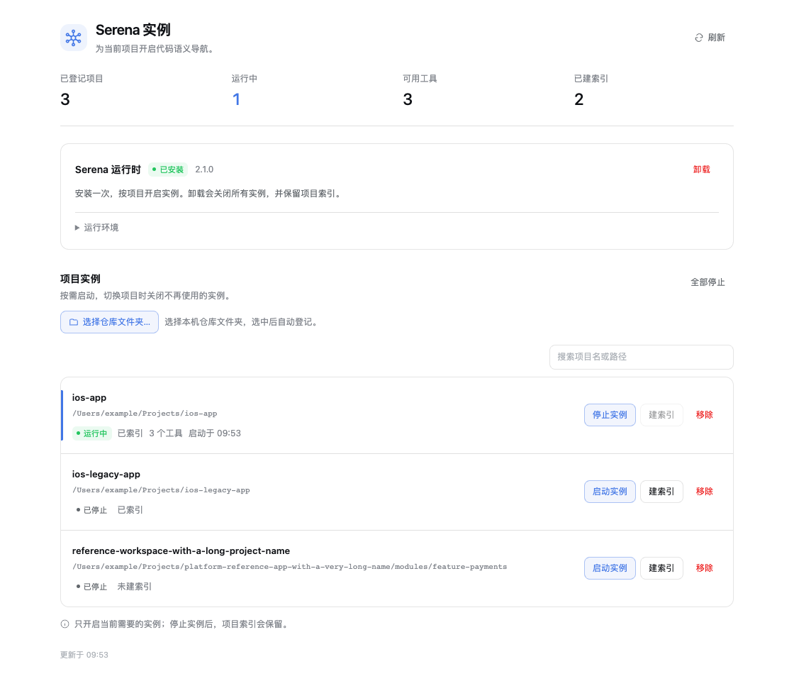
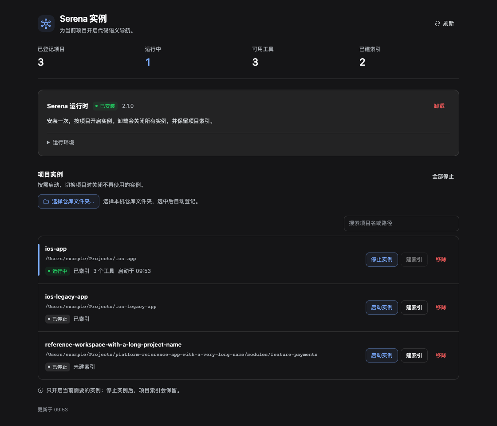
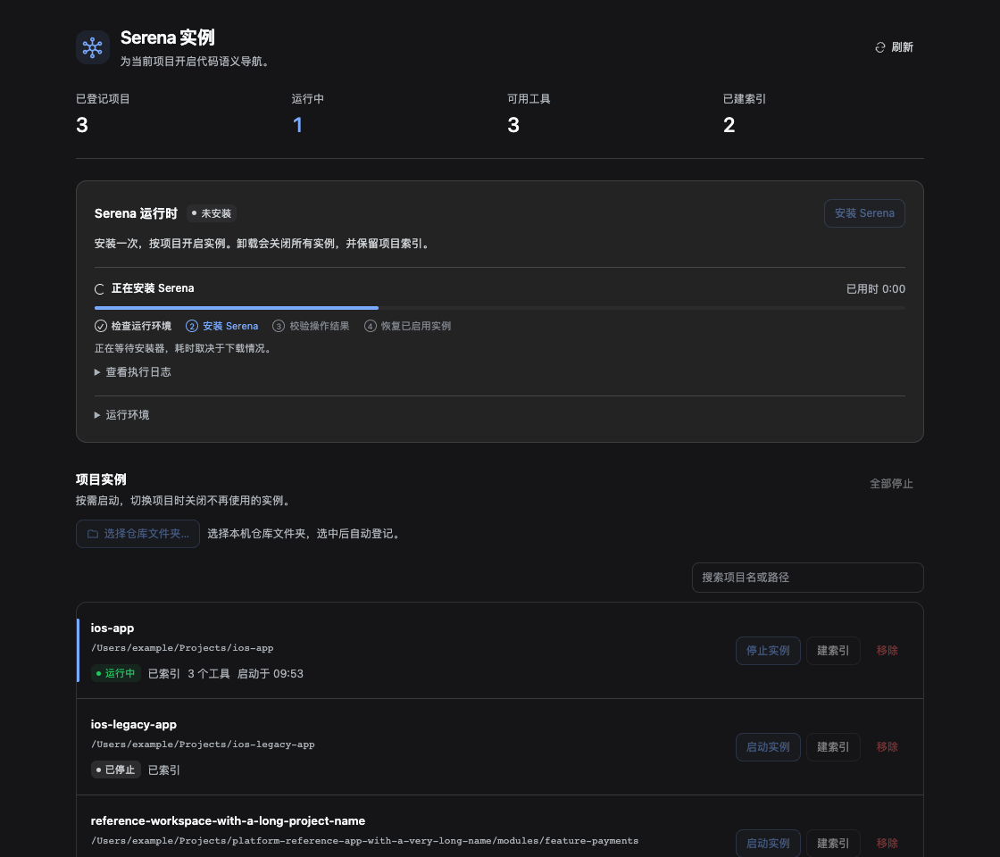
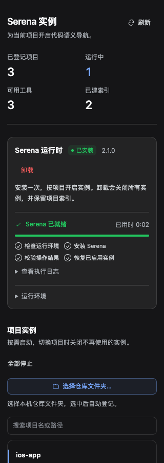

# serena-manager

A DSH plugin that installs, runs and supervises **[Serena](https://github.com/oraios/serena)** MCP instances per project, from a side panel instead of hand-editing the profile.

English · [简体中文](./README.zh-CN.md)



## Why

Serena gives an agent semantic code navigation (definitions, references, symbol bodies) over MCP. Wiring it into DSH by hand costs a profile edit and an app restart per project. This plugin keeps the Serena runtime, the per-project MCP servers and the project registry in one place:

- **Installs Serena once** with `uv tool install -p 3.13 serena-agent` — never bundled, always the upstream package.
- **Starts and stops one MCP server per project on demand.** Each instance is a separate MCP client fiber, so stopping a project kills its child process and unregisters its tools without touching the profile.
- **Keeps one project active.** Every live instance adds its tool schema to the model's context (~1.1k tokens), so the panel is built around "one project at a time".
- **Builds the symbol index** (`serena project index`) and shows whether `.serena/cache/<language>/document_symbols.pkl` exists and how fresh it is.

## Screenshots

| Light | Dark |
| --- | --- |
|  |  |

| Install in progress | Narrow panel (320 px) |
| --- | --- |
|  |  |

The screenshots are rendered by `tests/ui-fixture.mjs` against the real DSH theme bundle, with a mocked HTTP backend and a mocked folder picker. They are a browser fixture, not a capture of the Electron app, and the demo projects are placeholders.

## Requirements

- DSH desktop app with plugin support (`dsh.profile.bundles` + client slots).
- `uv` on `PATH` or at `~/.local/bin/uv` (override with `SERENA_MANAGER_UV`).
- macOS or Linux. The panel registers a native folder picker through `window.__DSH_DIRECTORY_PICKER__`, which the desktop app provides; in a plain browser the panel explains that and disables the action.
- Serena v2 (`serena-agent`). The plugin installs and verifies it; you do not need it beforehand.

## Install

The plugin is consumed as a linked local bundle, so the checkout can stay wherever you cloned it:

```bash
git clone https://github.com/PetterWong-L/serena-manager.git
cd serena-manager
```

Register the package in your DSH profile (`~/.dsh/profiles/<profile>/package.json`): it goes in `dependencies` as a link, and its name goes in the bundle list so the profile actually loads it.

```json
{
  "dependencies": {
    "@local/serena-manager": "link:/absolute/path/to/serena-manager"
  },
  "dsh": {
    "profile": {
      "bundles": ["@local/serena-manager"]
    }
  }
}
```

Install it into the profile:

```bash
dsh plugin --profile desktop install
```

`cordis.patch.yml` is the bundle patch the profile applies — it deliberately contains no machine-specific paths. If the profile needs a custom location for the registry and logs, add a config block:

```yaml
- insert:
    - id: serena-manager
      name: '@local/serena-manager'
      config:
        storageDir: /some/other/place/serena-manager
```

Then restart DSH, or let HMR pick the plugin up, and open the **Serena 实例 / Serena Instances** entry in the side panel.

## Use

1. **Install Serena** — the runtime card runs the install, streams the output and verifies the binary afterwards. Uninstall removes the tool but keeps your project indexes.
2. **Add a project** — *选择仓库文件夹…* opens the native picker; the folder is registered by path and slug (the slug becomes the MCP server name `serena-<id>`).
3. **Start** — starts the MCP server for that project only. *Index* builds the symbol cache with Swift as the default language; *Stop* disposes the fiber and the child process.
4. **Stop all** — the panic button when you want the tool schema out of the context.

The same operations are available to the agent through the `serena_manager` tool: `status`, `install`, `uninstall`, `add`, `remove`, `start`, `stop`, `stop-all`, `index`. `status` is the only concurrency-safe action; everything else mutates which tools the profile exposes.

## How it works

```
DSH profile
└── serena-manager (host plugin, index.js)
    ├── Store        ~/.dsh/serena-manager/state.json  (projects, autoStart)
    ├── Instances    one mcp-client fiber per running project
    │                 └── child: serena start-mcp-server --context codex --project <path>
    ├── Routes       GET  /serena-manager/snapshot
    │                POST /serena-manager/manage
    └── Tool         serena_manager
```

- **One fiber per project.** `ctx.plugin({ inject, apply }, config)` registers the upstream `@deepseek-ai/dsh-mcp-client` for that server; disposing the fiber disposes the stdio transport, which stops the child and unregisters the tools. No profile edit, no app restart.
- **Module resolution.** The mcp-client is imported with `ctx.loader.import`, with a `.asar`/profile path scan as a fallback, so the plugin works from a linked checkout or from inside the packaged app.
- **Index detection.** An index is "present" when `<repo>/.serena/cache/<language>/document_symbols.pkl` exists; its mtime is shown as freshness. Nothing is inferred from a running server.
- **Progress.** Install/uninstall are serialized and report real phases (`preparing → installing → verifying → complete`, or `stopping → uninstalling → verifying`). No fabricated percentages; the log tail is capped at 16,000 characters.
- **Stop order.** stdin EOF, then `SIGTERM`, then `SIGKILL`. Ports in use: dashboard 24282+, Serena tray manager 24224, `start-project-server` 24225.

### Configuration

| Setting | Default | Notes |
| --- | --- | --- |
| `storageDir` | `~/.dsh/serena-manager` | Holds `state.json` and `load.log`. |
| `SERENA_MANAGER_UV` | `~/.local/bin/uv` | Absolute path to `uv`; `PATH` and Homebrew locations are also probed. |
| `serenaHome` | `<storageDir>/home` | Passed to the child as `SERENA_HOME`. |

### Security

Both routes sit behind the DSH connection owner check: only the owner browser peer is admitted, a foreign `Origin` or `Sec-Fetch-Site: cross-site` is rejected, request bodies must be JSON and are capped at 64 KiB, and responses are JSON with `nosniff`. Mutations are an allowlist of actions, and every command is spawned with an argv array — no shell, no string interpolation. Paths are resolved to absolute, real paths and must be existing directories. No credentials or tokens are stored or logged; the plugin never sees your API keys.

## Testing

```bash
npm test          # host smoke (mocked cordis context) + panel contract
npm run test:vm   # 12 mocked backend scenarios; needs node --experimental-vm-modules
```

The VM suite mocks `child_process`, the filesystem and the clock, so it exercises the install/uninstall state machine, the HTTP guards and the progress reporting without installing anything or spawning Serena.

The UI fixture needs a browser and the DSH theme bundle, so its inputs are environment variables:

```bash
PLAYWRIGHT_MODULE=/path/to/playwright/index.mjs \
DSH_THEME_CLIENT=/path/to/@deepseek-ai/dsh-client-ui-theme/lib/client.js \
REACT_UMD_DIR=/path/to/node_modules \
CHROME_PATH='/Applications/.../Microsoft Edge' \
npm run test:ui
```

Without those variables the fixture prints `SKIP` and exits 0. With them it renders the panel in light/dark, checks the native picker contract, drags the viewport down to 320 px and regenerates `artifacts/`.

## Limitations

- One active instance per project is supported; running several at once multiplies the tool schema in context.
- The panel is the only place with the native folder picker; the agent tool takes a path directly.
- `state.json` is per machine and not synced. Stopping a project persists `enabled: false`, so it will not autostart next launch.
- macOS and Linux only; Windows paths and process semantics are untested.
- A failed MCP handshake can still leave `running: true` with zero tools, because the mcp-client fiber is created without `failOnStartupError`.

## License

MIT — see [LICENSE](./LICENSE).
