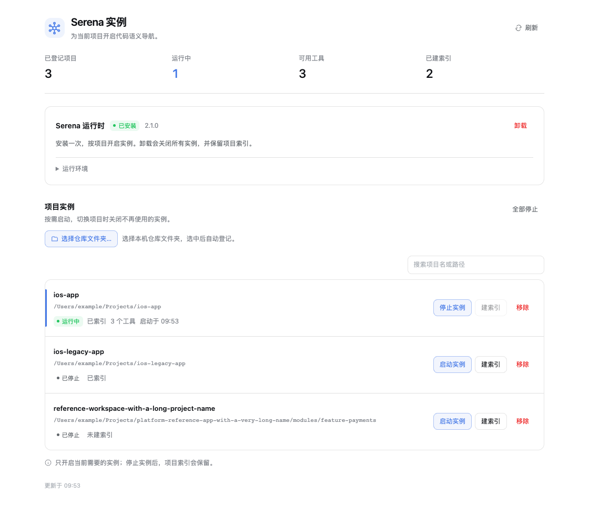
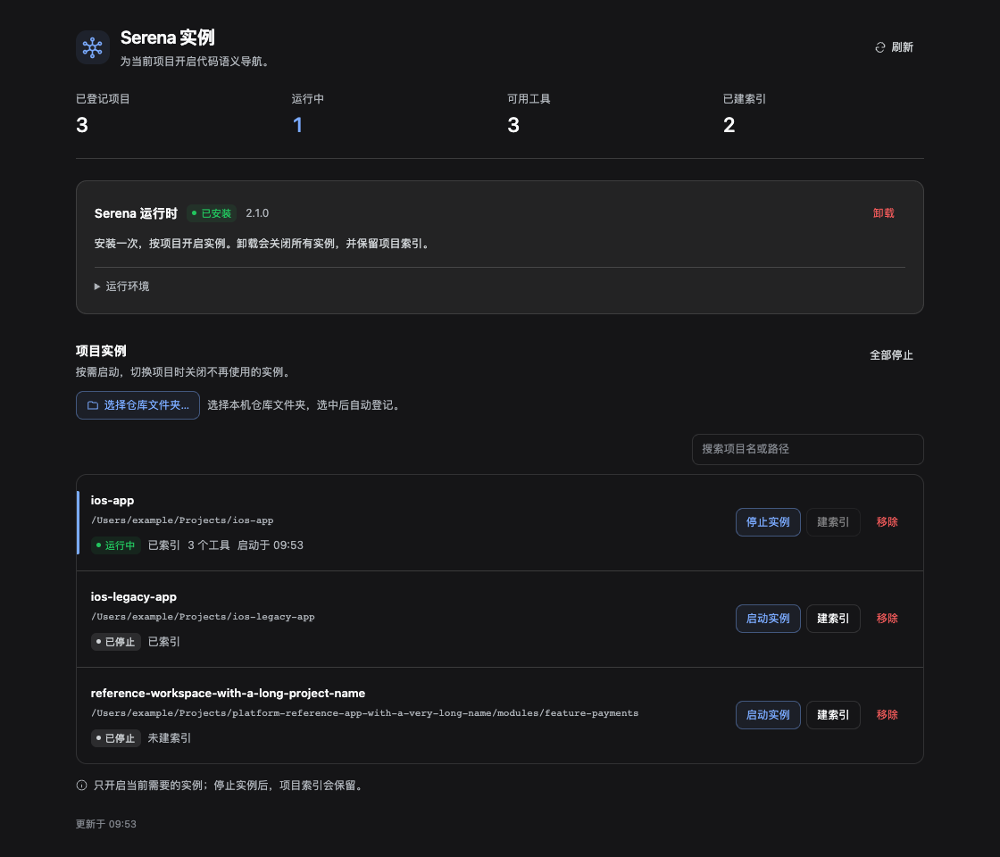
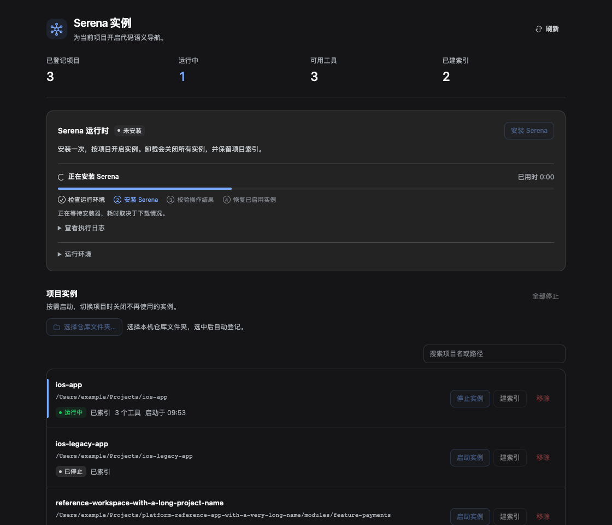
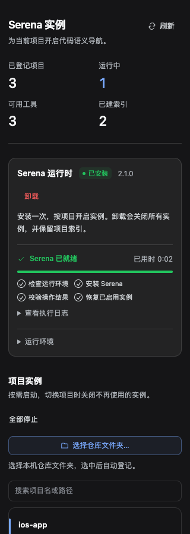

# serena-manager

一个 DSH 插件：按项目管理 **[Serena](https://github.com/oraios/serena)** MCP 实例的安装、启动与停止，不用手改 profile。

[English](./README.md) · 简体中文



## 解决什么问题

Serena 通过 MCP 给 agent 提供语义代码导航（定义、引用、符号体）。手工接进 DSH，意味着每个项目都要改一次 profile、重启一次应用。这个插件把 Serena 运行时、按项目的 MCP server 和项目清单放在一处：

- **只装一次 Serena**：走 `uv tool install -p 3.13 serena-agent`，不打包二进制，始终用上游包。
- **按需启停**：每个项目一个 MCP client fiber，停掉项目即杀掉子进程并注销工具，不改 profile、不重启应用。
- **同一时间只留一个项目**：每个活着的实例都会把工具 schema 塞进上下文（约 1.1k tokens），所以面板围绕"一次一个项目"设计。
- **建索引**：跑 `serena project index`，并展示 `.serena/cache/<language>/document_symbols.pkl` 是否存在、多新。

## 截图

| 浅色 | 深色 |
| --- | --- |
|  |  |

| 安装进行中 | 窄面板（320 px） |
| --- | --- |
|  |  |

截图由 `tests/ui-fixture.mjs` 渲染：真实 DSH 主题包 + 模拟 HTTP 后端 + 模拟文件夹选择器。它是浏览器 fixture，不是 Electron 应用实拍；演示项目都是占位名。

## 前置条件

- 支持插件的 DSH 桌面应用（`dsh.profile.bundles` + client slot）。
- `uv` 在 `PATH` 或 `~/.local/bin/uv`（可用 `SERENA_MANAGER_UV` 覆盖）。
- macOS 或 Linux。面板通过 `window.__DSH_DIRECTORY_PICKER__` 调原生文件夹选择器，这是桌面应用提供的；普通浏览器里面板会说明原因并禁用该操作。
- Serena v2（`serena-agent`）。由插件安装并校验，不需要预先装好。

## 安装

插件以本地链接包的方式接入，仓库可以放在任意位置：

```bash
git clone https://github.com/PetterWong-L/serena-manager.git
cd serena-manager
```

在 DSH profile（`~/.dsh/profiles/<profile>/package.json`）里登记：`dependencies` 里加链接，同时把包名加进 bundle 列表，profile 才会真正加载它。

```json
{
  "dependencies": {
    "@local/serena-manager": "link:/absolute/path/to/serena-manager"
  },
  "dsh": {
    "profile": {
      "bundles": ["@local/serena-manager"]
    }
  }
}
```

装进 profile：

```bash
dsh plugin --profile desktop install
```

`cordis.patch.yml` 是这个 bundle 的 patch，故意不含任何机器相关路径。需要改注册表和日志的位置时，在 profile 的 patch 层里加 config：

```yaml
- insert:
    - id: serena-manager
      name: '@local/serena-manager'
      config:
        storageDir: /some/other/place/serena-manager
```

然后重启 DSH（或等 HMR 接上），在侧边栏打开 **Serena 实例**。

## 使用

1. **安装 Serena**：运行时卡片执行安装、流式输出日志、并在结束后校验二进制。卸载会移除工具，但保留项目索引。
2. **添加项目**：*选择仓库文件夹…* 打开原生选择器，按路径登记；slug 会成为 MCP server 名 `serena-<id>`。
3. **启动**：只启动该项目的 MCP server。*建索引* 默认按 Swift 生成符号缓存；*停止* 释放 fiber 和子进程。
4. **全部停止**：想把工具 schema 从上下文里清掉时的兜底按钮。

同样的能力也通过 `serena_manager` 工具给 agent：`status`、`install`、`uninstall`、`add`、`remove`、`start`、`stop`、`stop-all`、`index`。只有 `status` 是并发安全的，其余动作都会改变 profile 暴露的工具集合。

## 实现要点

```
DSH profile
└── serena-manager（宿主插件，index.js）
    ├── Store        ~/.dsh/serena-manager/state.json（项目、autoStart）
    ├── Instances    每个运行中的项目一个 mcp-client fiber
    │                 └── 子进程：serena start-mcp-server --context codex --project <path>
    ├── Routes       GET  /serena-manager/snapshot
    │                POST /serena-manager/manage
    └── Tool         serena_manager
```

- **一项目一 fiber**：`ctx.plugin({ inject, apply }, config)` 为该 server 注册上游 `@deepseek-ai/dsh-mcp-client`；dispose fiber 即 dispose stdio transport，子进程退出、工具注销。
- **模块解析**：用 `ctx.loader.import` 引入 mcp-client，附带 `.asar`／profile 路径扫描兜底，所以在链接的 checkout 和打包应用内都能工作。
- **索引判定**：`<repo>/.serena/cache/<language>/document_symbols.pkl` 存在即"已建索引"，mtime 作为新鲜度；不从运行中的 server 猜。
- **进度**：安装/卸载串行执行，报真实阶段（`preparing → installing → verifying → complete`，或 `stopping → uninstalling → verifying`），不编造百分比，日志尾巴上限 16,000 字符。
- **停止顺序**：stdin EOF → `SIGTERM` → `SIGKILL`。涉及的端口：dashboard 24282+、Serena tray manager 24224、`start-project-server` 24225。

### 配置

| 项 | 默认值 | 说明 |
| --- | --- | --- |
| `storageDir` | `~/.dsh/serena-manager` | 存放 `state.json` 和 `load.log`。 |
| `SERENA_MANAGER_UV` | `~/.local/bin/uv` | `uv` 的绝对路径；也会探测 `PATH` 和 Homebrew 位置。 |
| `serenaHome` | `<storageDir>/home` | 作为 `SERENA_HOME` 传给子进程。 |

### 安全

两条路由都在 DSH 连接属主校验之后：只接受属主浏览器 peer，陌生 `Origin` 或 `Sec-Fetch-Site: cross-site` 直接拒绝，请求体必须是 JSON 且不超过 64 KiB，响应是 JSON 并带 `nosniff`。变更动作是白名单，命令一律用 argv 数组启动——不走 shell、不做字符串拼接。路径会被解析成绝对真实路径，且必须是已存在的目录。插件不存储、不记录任何凭据或 token，也看不到你的 API key。

## 测试

```bash
npm test          # 宿主冒烟（模拟 cordis 上下文）+ 面板契约
npm run test:vm   # 12 个模拟后端场景，需要 node --experimental-vm-modules
```

VM 套件把 `child_process`、文件系统、时钟都做成了 mock，所以能在不安装任何东西、不启动 Serena 的前提下跑安装/卸载状态机、HTTP 守卫和进度上报。

UI fixture 需要浏览器和 DSH 主题包，因此输入走环境变量：

```bash
PLAYWRIGHT_MODULE=/path/to/playwright/index.mjs \
DSH_THEME_CLIENT=/path/to/@deepseek-ai/dsh-client-ui-theme/lib/client.js \
REACT_UMD_DIR=/path/to/node_modules \
CHROME_PATH='/Applications/.../Microsoft Edge' \
npm run test:ui
```

不给这些变量时 fixture 打印 `SKIP` 并退出 0；给了就渲染浅色/深色、检查原生选择器契约、把视口压到 320 px，并重新生成 `artifacts/`。

## 已知限制

- 每个项目同时只支持一个活动实例；开多个会让工具 schema 在上下文里翻倍。
- 原生文件夹选择器只在面板里；agent 工具直接收路径。
- `state.json` 是单机状态、不同步。停止项目会持久化 `enabled: false`，下次启动不会自启。
- 仅支持 macOS 与 Linux；Windows 的路径和进程语义未验证。
- MCP 握手失败时可能仍显示 `running: true` 但工具为 0，因为创建 mcp-client fiber 时没有设 `failOnStartupError`。

## 许可证

MIT，见 [LICENSE](./LICENSE)。
